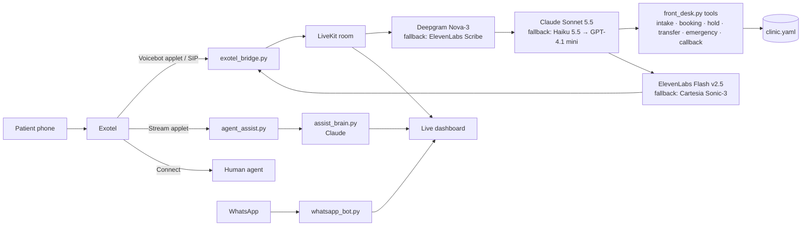

# Eye-Clinic Front Desk: an AI voice agent that answers, and an AI copilot for the human who answers

**A production-grade phone receptionist for eye hospitals in India**, built on LiveKit Agents
with Claude, Deepgram and ElevenLabs. It answers patients in **English, Hindi and Hinglish**,
follows the hospital's own call scripts word for word, treats eye emergencies as emergencies,
and never diagnoses or makes up a fee.

It also has a second mode most voicebots don't: **Agent Assist**. When a *person* at the
clinic takes the call, Claude listens in silently and puts the next best reply on the agent's
screen, in the patient's own language, while the patient is still on the line.

> Built for and tested on real eye hospitals, from a multi-centre network to a single-surgeon
> retina clinic. A new clinic is one YAML file (`config/clinic.yaml`), no
> code changes. This repo ships with a **fictional demo clinic** (Demo Eye and Retina Clinic,
> Dr. Arjun Mehta); swap in your own.

---

## What makes it different from a normal voicebot

Most voicebots are a speech-to-text → LLM → text-to-speech loop with a prompt on top. That
demos well and breaks on a real hospital phone line. This one was built around how the clinic's
front desk actually works, and around the ways those loops fail.

| | Typical voicebot | This project |
|---|---|---|
| **Who it helps** | Replaces the human | Two modes: **AI answers the call**, or **AI coaches the human answering it** (Agent Assist) |
| **Script** | "Be a helpful receptionist" prompt | The hospital's call SOPs (opening, outbound, hold, transfer) built into the prompt and code. Fixed lines are spoken **word for word**, and a live checklist ticks off each step |
| **Facts** | Whatever the LLM remembers | Only what's in `clinic.yaml` (in production, the hospital's own published data). Unknown fee, timing or doctor → "our team will confirm", never a guess |
| **Language** | English, maybe Hindi | English, Hindi, **Hinglish code-switching**. Hindi day and time words are computed in code, because the LLM once turned 10:30 into "सवा दस" (10:15) |
| **Safety** | Hope the prompt holds | Never diagnoses, never advises medicine. Emergency red flags (chemical splash, sudden vision loss) alert staff **first**, then tell the caller to come in now |
| **Hold / transfer** | Dead air, or a cold transfer | Hold SOP (announce, music, check-ins, **never over a minute**, then callback). **Warm transfer**: briefs the colleague first, connects only if they pick up |
| **Turn-taking** | Stops at every "hmm" | Audio turn detector + adaptive interruption: ignores "haan ji" and stops fast when the caller really talks over it (Exotel `clear`) |
| **Outages** | Call dies | Every layer has a fallback chain (STT, LLM, TTS). If all LLMs are down: apology, human callback, clean hang-up. **Never dead air** |
| **Tone** | Whatever the TTS does | Tuned to never sound rude or loud: calm voice settings, -6 dB with a peak limiter on the phone line, polite आप forms, never asks the same question twice |
| **Proof** | "It works on my demo" | LLM-judged evals per scenario, 270+ offline tests, latency benchmark against published targets ([BENCHMARK.md](BENCHMARK.md)) |

---

## ⭐ Agent Assist: a live copilot for the human agent

Not every call should go to a bot. For the calls a person takes, the same brain sits beside
them instead of replacing them.

```
 Patient ──phone──▶ Exotel ──▶ rings the human agent (Connect applet)
                      │
                      └── copy of the call audio (Stream applet, listen-only)
                                   │
                                   ▼
                  Deepgram Nova-3 (Hindi + English, speaker diarization)
                                   │   one line per finished sentence
                                   ▼
                  Claude + clinic facts + front-desk SOP
                                   │
                                   ▼
                  Agent's screen (live dashboard)
```

**What the agent sees, live:**
- **Suggested reply**, in the patient's language (English, Hindi or Hinglish), with a one-line *why*. The first words stream in about **1 s** after the patient stops speaking (Haiku; Sonnet ≈ 2.5 s for richer wording).
- **Facts they need right now** (up to 2): the doctor's centre, the address with landmark, what to bring. All taken from the clinic file, never invented.
- **Booking form filling itself**: name, age, city, centre, doctor, day, time and concern, picked up from the conversation.
- **Alerts**: emergency red flags, an upset patient (mood from words *and* voice loudness against the caller's own normal).
- **SOP checklist** ticked from the agent's own words, so new staff follow the script without reading it.
- **After the call**: a short note, the outcome (appointment request, enquiry, callback…) and the follow-up.

**Nothing it does can be heard on the call.** The stream is one-way. The same safety rules
apply as for the voice bot: no diagnosis, no medicine advice, no invented fees or timings.

Code: [`src/agent_assist.py`](src/agent_assist.py) (audio → transcript),
[`src/assist_brain.py`](src/assist_brain.py) (transcript → suggestions),
[`src/dashboard_hub.py`](src/dashboard_hub.py) (the screen).

---

## The voice agent

When no person is free, the bot answers the call itself:

1. **Greets** with a pre-recorded line (no LLM wait), says it's a virtual assistant.
2. **Takes details gently**, one question at a time: name, age, city, concern. Names are used exactly as given.
3. **Finds the right doctor or centre** without guessing a specialty from symptoms, which would be an implied diagnosis.
4. **Books**: registers an appointment request (or a real slot once the hospital's system is connected) and reads the scripted confirmation: doctor, location with landmark, time, visit length, fee note, dilation warning, SMS.
5. **Closes** with the scripted line and hangs up only after the goodbye has finished playing.

**Outbound mode**: calls back leads (say, from WhatsApp). It detects answering machines and hangs up without
leaving a message, waits for the person's "Hello?", and refuses to call outside 9 AM-9 PM.

**Also included**
- 💬 **WhatsApp bot**: the same front desk in writing, replying in the script the patient types (Latin, Devanagari or Hinglish).
- 📊 **Live dashboard**: every call and chat as it happens. A 3D iris shows the caller's mood. It also shows script compliance, reply speed against the 0.9 s target, alerts, and a scorecard and cost for every call. It runs locally and masks phone numbers.

---

## Architecture



| Layer | Choice | Why |
|---|---|---|
| Framework | LiveKit Agents 1.8 | Best barge-in and end-of-turn models, warm transfer, SIP, built-in simulation |
| Turn-taking | LiveKit Turn Detector v1 + adaptive interruption | Ignores backchannels, stops fast on real interruptions |
| STT | Deepgram Nova-3 multilingual | Handles Hindi-English code-switching on 8 kHz phone audio |
| LLM | Claude Sonnet 5.5 (effort low) | 100% on the SOP and safety evals (Haiku: 94%) |
| TTS | ElevenLabs Flash v2.5 | Low latency, Indian voices |
| Telephony | Exotel (Voicebot applet today, SIP trunk for production) | The clinic's existing provider |

Every provider is one line in `.env.local` (`STT_CHAIN`, `LLM_CHAIN`, `TTS_CHAIN`), primary first.

---

## Results

| | Result |
|---|---|
| SOP + safety evals (LLM-judged, real clinic data) | **100% scenarios, 100% safety** (Sonnet 5.5) |
| Reply speed (first word after the caller stops) | **~1.0 s** typical, target 0.9 s |
| Cost | **~₹1.9** per booking call (LLM) |
| Eval progression while building | 49% → 67% → 74% → 79% → 100% → 92% → 98% over 7 rounds (rounds 6-7 ran 5× per scenario) |

[BENCHMARK.md](BENCHMARK.md) has the targets, how each number is measured, and **34 real
failures found and fixed during the build**: a crash before the greeting, dead air from a cut-off
tool call, the model "thinking aloud" into speech, a renamed patient, and more.

---

## Quick start (Windows / PowerShell)

```powershell
winget install astral-sh.uv
uv sync
copy .env.example .env.local           # fill in your keys
uv run python src/agent.py preflight   # READY, or exactly which keys are missing
uv run pytest                          # offline test suite

uv run python src/agent.py console --text   # chat with the bot (needs only an LLM key)
uv run python src/agent.py console          # talk to it through your mic
DASHBOARD-DEMO.bat                          # the dashboard with sample calls, incl. an assisted call
WHATSAPP-TEST-CHAT.bat                      # the WhatsApp bot, no WhatsApp needed
```

Phone setup (Exotel bridge, SIP trunk, outbound calls), WhatsApp, the dashboard and Agent Assist
are covered step by step in **[docs/OPERATIONS.md](docs/OPERATIONS.md)**.

---

## Project layout

```
config/clinic.yaml      everything the bot may say about the clinic (validated on start)
src/agent.py            entrypoint: session, turn-taking, noise cancellation, outbound dialing
src/front_desk.py       the agent + tools (intake, availability, booking, callback,
                        do-not-call, emergency, warm transfer, end call)
src/prompts.py          system prompt built from the clinic's call scripts
src/lines.py, speech.py fixed EN/HI lines spoken word for word (no LLM latency)
src/hold.py, guards.py  hold SOP, silence, max call length, outage failsafe, clean hang-up
src/providers.py        STT/LLM/TTS fallback chains
src/exotel_bridge.py    Exotel <-> LiveKit (calls without SIP), barge-in, loudness control
src/agent_assist.py     Agent Assist: call audio -> diarized transcript
src/assist_brain.py     Agent Assist: transcript -> suggestions, facts, form, alerts, wrap-up
src/dashboard_hub.py    live dashboard; sop_checklists.py scores script compliance
src/whatsapp_bot.py     the same front desk on WhatsApp
bench/                  latency, STT, eval and phone-simulation benchmarks
tests/                  offline tests + live LLM-judged evals
docs/OPERATIONS.md      full setup and operations guide
```

## Status

Working end to end on an Exotel trial line (inbound voice, WhatsApp, Agent Assist, dashboard).
Before going live, the clinic still needs to provide OPD timings or appointment-system access,
department numbers for transfers, and doctor sign-off on the emergency advice. The full
checklist is in [docs/OPERATIONS.md](docs/OPERATIONS.md#going-live-checklist).

## License

MIT. Builds on the LiveKit Agents starter template.
